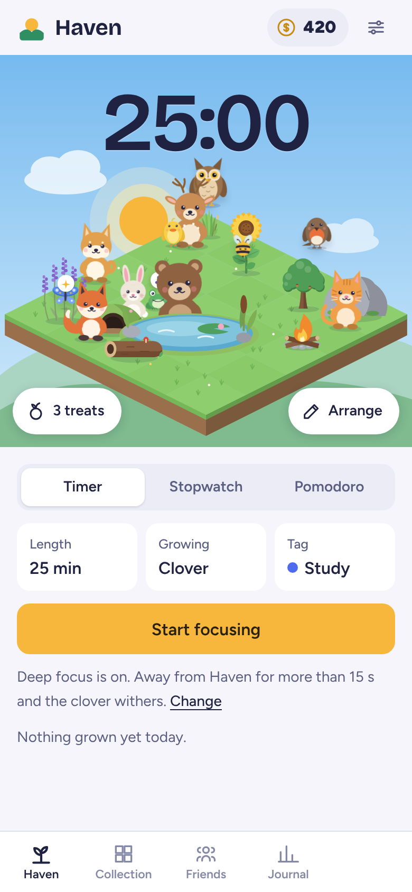
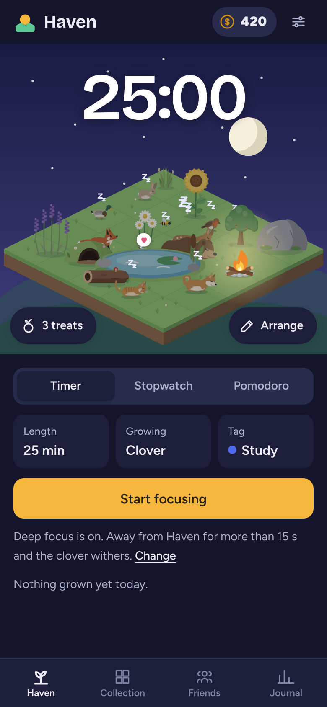
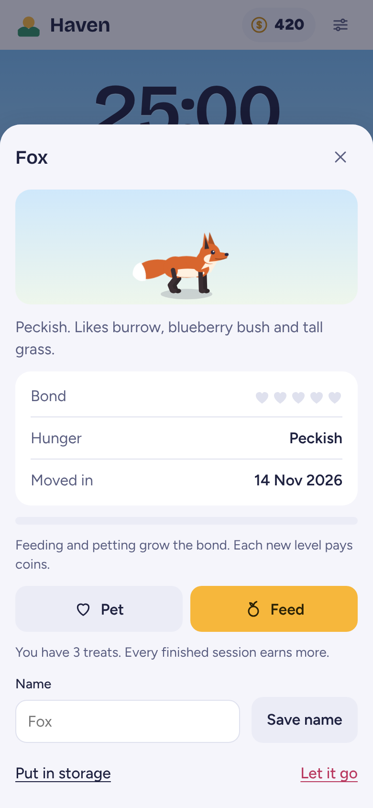
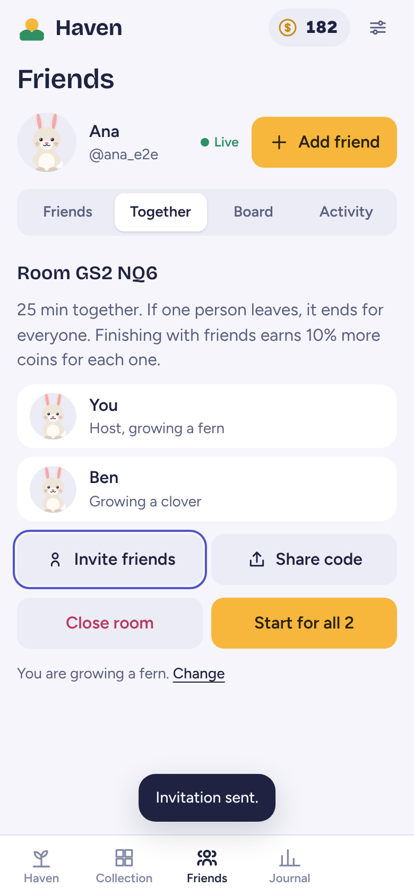
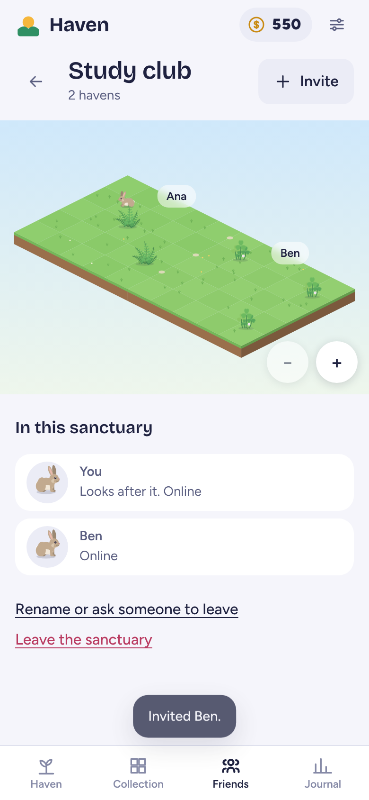
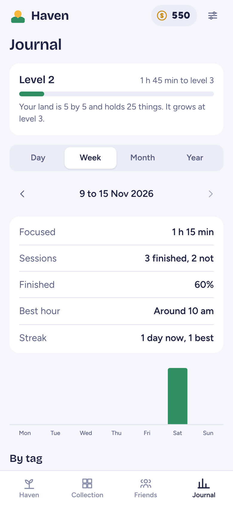

# Haven (vibe coded)

A focus timer that grows a living sanctuary. Set a time, stay with it, and a plant grows, an animal moves in, or a pond gets dug in your haven. Leave early and it is lost. The animals are not ornaments: they wander, visit the plants and places they like, greet each other, sleep at night, and get hungry. Friends see each other focus live, sit round a campfire to focus together, share a sanctuary, cheer each other on and send gifts.

One web app runs everywhere: in a browser, installed from the browser on iPhone and Android, and inside small native apps for iOS and Android. Everything is unlocked for everyone. There is nothing to buy.

| Your haven by day | By night | A session | Caring for an animal |
| --- | --- | --- | --- |
|  |  |  |  |

| Friends, live | A campfire | A sanctuary | Journal |
| --- | --- | --- | --- |
|  |  |  |  |

## What it does

- **The haven is the home screen.** Your land floats under a sky that follows the time of day. Start a session and a day passes over it: the sun rises, crosses and sets as the time runs, while the new plant grows where it was planted.
- **Animals with lives of their own.** 29 animals, from a ladybird to an elephant, drawn in profile with legs, wings, tails and heads that move. They walk and trot, hop in arcs, fly and land, and steer round rocks and water. Frogs, ducks and otters swim in the pond with ripples round them; deer drink at its edge; rabbits and foxes go down the burrow; birds and squirrels sit up in the trees; bees land on the flower heads; cats lie by the fire. Plants rustle as animals brush past. After dark the day animals lie down and sleep while owls, foxes and hedgehogs stay up. Tap a sleeping animal and it wakes, yawns, and dozes off again once left alone. Tap the ground and whoever is near comes over.
- **Dogs, your way.** A dog can be any of seven breeds: mixed, shiba, golden retriever, corgi, husky, dalmatian or dachshund. Choose in its care sheet and change your mind any time.
- **Care.** Every finished session earns treats. Put a treat down on the land and the hungriest animal trots over to eat it. Tap an animal to pat it, or stroke it with your finger, and it shows how it feels. Name them, and watch the bond grow through five levels, each paying coins. A hungry animal is slow and glum, and says so. Nothing ever dies or leaves because you were away.
- **Nature you build.** A pond, a campfire, a burrow, a beehive, a bird house and more. Each needs a session of a minimum length (a pond takes 60 min), and animals come to use them. The fire and the lantern glow at night.
- **29 plants** too, from clover to lily, bougainvillea and cherry blossom. Longer sessions grow bigger ones. Things unlock with coins, through goals (a 7-day streak brings a bear), or free in their season.
- **Timer, stopwatch and pomodoro.** 5 to 180 minutes, a count-up stopwatch, or pomodoro rounds with breaks.
- **Deep focus.** Leave Haven for longer than the time you allow (30 s to 2 min) and the session is lost. A third of the way through, a notification asks you to come back. The phone can lock as usual during a session: that does not count as leaving. In the apps Haven can tell the two apart itself; in a phone's browser, which cannot, Haven reads the signs (whether the phone slept, whether a swipe took you away) and counts only time it can see you spent in another app, so the screen can stay off for the whole session. Keeping the screen on is a setting.
- **Arrange freely.** Drag anything anywhere on the land. The land grows with your level, from room for 25 things to room for 100.
- **Friends, live.** Add people by code, username or invite link. See who is focusing right now and for how long. Cheer or nudge them. Visit their haven. Send them a plant, an animal or a piece of nature.
- **Sanctuaries.** Make a group of up to eight havens and they are joined into one land around a clearing. Everyone's animals wander from haven to haven, and animals from different havens become pals. A great tree in the middle grows through the week as everyone focuses, and blooms when the group reaches its goal. Put treats down for anyone's animals and pat them; their people hear about it. Add anyone in it as a friend, or report or block them.
- **Campfire.** Light a campfire and invite friends, or light one in a sanctuary for everyone there to join, and everyone starts at the same moment. Choose whether one person leaving puts the fire out for everyone at once (finishing pays 1.2× coins) or only costs them. Finishing together earns more coins. A finished campfire stays, showing how everyone did, until each person leaves it.
- **Board and activity.** Rank yourself and your friends for today, the week, the month or all time, and see what everyone grew.
- **Journal.** Day, week, month and year views with a chart, time by tag, best hour, streaks, every session, and 29 achievements.
- **Sounds.** Rain, stream, wind, night crickets, campfire, brown and white noise, made on the device, so they work offline. A chime when a session finishes and a falling one when it is lost; in the phone apps these come as notifications too, with the screen off.
- **Notifications.** A session finishing, a reminder to come back, friend requests and acceptances, invitations, cheers, nudges and gifts, a streak about to end, hungry animals, and a daily reminder. Each can be switched off. Haven asks for permission at your first session, and Settings says if notifications are off and takes you to turn them on. While Haven is closed, the apps check for friends' news about every 15 minutes.
- **An account that goes with you.** Haven opens on a sign-in screen: create an account with a username and a password, or continue with Google where the server offers it. Sign in on any phone or computer and your haven is there. What you grow, move, feed, buy or let go on one device reaches the others within seconds when they are open, and on opening otherwise. Nothing is lost when both changed at once.
- **Yours to keep.** Works offline. Light and dark. Backup file, server backup.

[PRODUCT.md](PRODUCT.md) lists exactly what is built and what is not.

## Get it

After the first successful build on `main`:

- **Web and iPhone:** open https://shira421.github.io/haven/. On an iPhone use Safari, then Share, then Add to Home Screen.
- **Android:** on Google Play once it is published ([PLAY.md](PLAY.md) is the checklist), or download `Haven-Android.apk` from the [latest build](https://github.com/shira421/haven/releases/tag/latest-build) and open it.
- **iPhone app:** download `Haven-iOS-unsigned.ipa` from the same page and install it with AltStore, SideStore or Sideloadly.

## Setting up the repository

Two things are done once in GitHub. Both are needed for the links above to work.

### 1. Turn on GitHub Pages

Repository Settings, then Pages, then set **Source** to **GitHub Actions**. Then run the "Deploy web app and friends server" workflow again from the Actions tab.

### 2. Switching accounts and friends on

Accounts and friends need a server. Haven's is a Cloudflare Worker that runs on Cloudflare's free plan. The workflow deploys it for you once the repository has two secrets, the same two Aeris uses:

1. Sign in at https://dash.cloudflare.com and open **Workers & Pages** once, so your account gets a `workers.dev` address.
2. Copy your **Account ID** from the right side of that page.
3. Go to My Profile, then API Tokens, then Create Token, and use the **Edit Cloudflare Workers** template.
4. In the repository: Settings, then Secrets and variables, then Actions. Add `CLOUDFLARE_ACCOUNT_ID` and `CLOUDFLARE_API_TOKEN`.
5. Run the "Deploy web app and friends server" workflow, then "Build apps".

The workflow deploys the server, checks that it answers, and builds the web app and the phone apps to use it. Until then Haven runs without accounts: there is no sign-in screen, the Friends screen says there is no server, and everything else works.

### 3. Signing in with Google (optional)

The "Continue with Google" button appears once the server has a Google OAuth client. Passwords work without it.

1. In the [Google Cloud console](https://console.cloud.google.com/), make a project, then open **APIs & Services**, then **OAuth consent screen**, and fill it in (External, your email, app name Haven). Publish it so anyone can sign in.
2. Open **Credentials**, then **Create credentials**, then **OAuth client ID**. Choose **Web application**.
3. Under **Authorised redirect URIs** add `https://haven-hub.<your workers.dev subdomain>.workers.dev/auth/google/callback` (your server's address followed by `/auth/google/callback`).
4. In the Cloudflare dashboard open **Workers & Pages**, then **haven-hub**, then **Settings**, then **Variables and Secrets**. Add two entries of type **Secret**: `GOOGLE_CLIENT_ID` and `GOOGLE_CLIENT_SECRET`, with the values Google showed. Secrets stay in place across deploys.
5. If your website is not at the address in `worker/wrangler.toml` (`HAVEN_SITE`), change it there, so people are sent back to the right page.

Haven asks Google only who the person is (`openid profile`). It never sees or stores a Google password.

### 4. Google Play

[PLAY.md](PLAY.md) walks through everything: the upload key, the GitHub secrets and settings, Play Console, the store listing (the screenshots and graphics are in `docs/play`), and testing.

### Keeping your haven across Android updates (optional)

Without a keystore each Android build is signed with a new key, so Android asks you to uninstall the old app first, which removes its data. Sign in on the Friends screen first and your haven is backed up and comes back. To avoid the uninstall altogether, make a keystore once and add it as secrets:

```sh
keytool -genkeypair -keystore haven.keystore -alias haven -keyalg RSA -keysize 2048 -validity 10000
base64 -w0 haven.keystore   # put this in the secret ANDROID_KEYSTORE_B64
```

Add `ANDROID_KEYSTORE_B64` and `ANDROID_KEYSTORE_PASSWORD`. Keep the keystore file somewhere safe and never commit it. The same keystore is the upload key for Google Play, and with it the downloads are release builds.

## Run it yourself

Needs Node 22.

```sh
npm ci
npm run build
npm start          # app on http://localhost:4173, Haven server on http://localhost:8787
```

`npm start` runs the real Haven server on your machine, on the same runtime Cloudflare uses, so two browser windows can add each other and focus together.

```sh
npm test               # rules, storage, the animal simulation, session controller, catalogue, and the Haven server
npm run test:browser   # two people in headless Chrome against the local Haven server
npm run media          # the same run, saving the screenshots in docs/media
npm run play-shots     # the same run on a 1080 x 1920 phone, saving Google Play's screenshots in docs/play
npm run icons          # redraw the app icons
```

## How it is built

[ARCHITECTURE.md](ARCHITECTURE.md) explains the parts. In short:

- `src/` is the web app in plain JavaScript modules, bundled by esbuild into `dist/`.
- `worker/` is the Haven server: one Durable Object with its own SQLite database and the live WebSocket connections.
- `ios/` and `android/` are thin apps that show `dist/` in a web view and add notifications, screen-on, haptics, sharing and lock detection.
- `.github/workflows/` tests everything, builds the apps, deploys the server and the website, and publishes downloads.

[VALIDATION.md](VALIDATION.md) records what has been checked and what has not.

## Privacy

Your account is kept on the Haven server: your name, username, sessions (start, length, what grew), your haven's layout, your friends, the sanctuaries you are in, and a copy of your haven so every device you sign in on has it. Your password is never stored: only a salted PBKDF2-SHA-256 hash of it is. If you connect Google, the server keeps Google's id for you and nothing else. Everyone in a sanctuary with you can see your haven's layout. There is no email address, no advertising and no tracking. Delete your account in Settings, or on the [account deletion page](https://shira421.github.io/haven/delete-account.html), and the server removes all of it. The full [privacy policy](https://shira421.github.io/haven/privacy.html) is on the website.

## Credits

The typefaces are Bricolage Grotesque and Figtree, both under the SIL Open Font License. All drawings are original to Haven. Haven is not affiliated with Forest or any other focus app.
