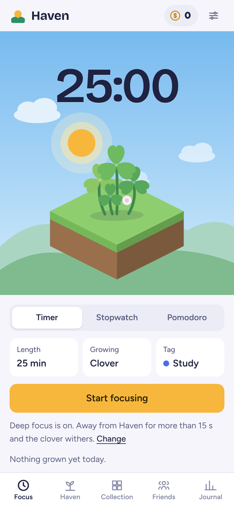
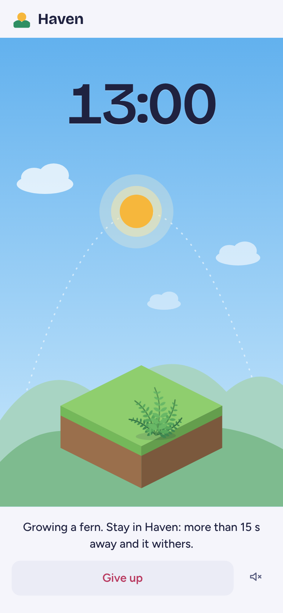
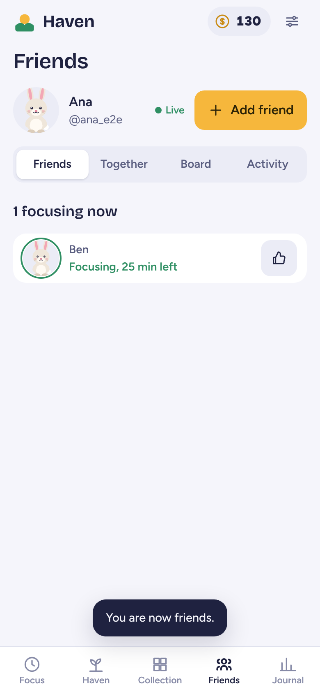
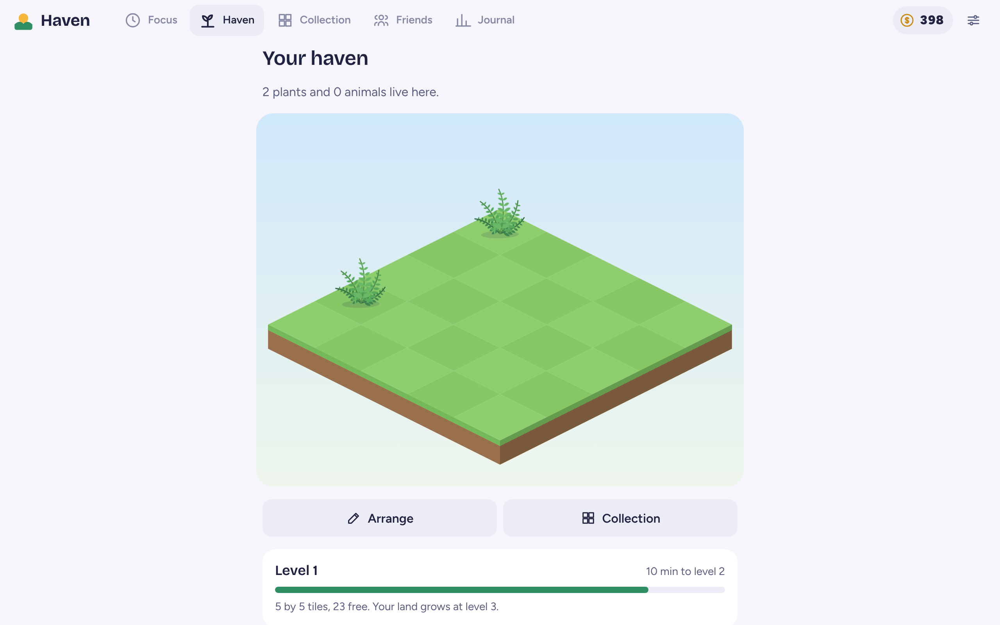

# Haven

A focus timer that grows a sanctuary. Set a time, stay with it, and a plant grows or an animal moves in to your haven. Leave early and it withers. Friends see each other focus live, grow together in rooms, cheer each other on and send gifts.

One web app runs everywhere: in a browser, installed from the browser on iPhone and Android, and inside small native apps for iOS and Android. Everything is unlocked for everyone. There is nothing to buy.

| Focus | A session | Friends, live | Your haven |
| --- | --- | --- | --- |
|  |  |  |  |

## What it does

- **Timer, stopwatch and pomodoro.** 5 to 180 minutes, a count-up stopwatch that grows something from 10 minutes, or pomodoro rounds with short and long breaks.
- **54 plants and animals**, all drawn for Haven. Longer sessions grow bigger ones. Unlock them with coins, earn some through goals (a 7-day streak brings a bear), and get seasonal ones free in their months.
- **Your haven.** An island that fills as you focus and grows with your level, from 5 by 5 tiles to 10 by 10. Arrange it how you like.
- **Deep focus.** Leave Haven for longer than the time you allow and the plant withers. In the apps, locking the phone does not count as leaving.
- **Friends, live.** Add people by code, username or invite link. See who is focusing right now and for how long. Cheer or nudge them. Visit their haven. Send them a plant or an animal.
- **Focus together.** Open a room, invite friends, and everyone starts at the same moment. Choose whether one person leaving ends it for everyone or only for them. Finishing together earns more coins.
- **Board and activity.** Rank yourself and your friends for today, the week, the month or all time, and see what everyone grew.
- **Journal.** Day, week, month and year views with a chart, time by tag, best hour, streaks, every session, and 25 achievements.
- **Sounds.** Rain, stream, wind, night crickets, campfire, brown and white noise, made on the device, so they work offline.
- **Yours to keep.** Works offline. Light and dark. Backup file, server backup, and moving to another device with a one-time code.

[PRODUCT.md](PRODUCT.md) lists exactly what is built and what is not.

## Get it

After the first successful build on `main`:

- **Web and iPhone:** open https://shira421.github.io/haven/. On an iPhone use Safari, then Share, then Add to Home Screen.
- **Android:** download `Haven-Android.apk` from the [latest build](https://github.com/shira421/haven/releases/tag/latest-build) and open it.
- **iPhone app:** download `Haven-iOS-unsigned.ipa` from the same page and install it with AltStore, SideStore or Sideloadly.

## Setting up the repository

Two things are done once in GitHub. Both are needed for the links above to work.

### 1. Turn on GitHub Pages

Repository Settings, then Pages, then set **Source** to **GitHub Actions**. Then run the "Deploy web app and friends server" workflow again from the Actions tab.

### 2. Switching friends on

Friends need a server. Haven's is a Cloudflare Worker that runs on Cloudflare's free plan. The workflow deploys it for you once the repository has two secrets, the same two Aeris uses:

1. Sign in at https://dash.cloudflare.com and open **Workers & Pages** once, so your account gets a `workers.dev` address.
2. Copy your **Account ID** from the right side of that page.
3. Go to My Profile, then API Tokens, then Create Token, and use the **Edit Cloudflare Workers** template.
4. In the repository: Settings, then Secrets and variables, then Actions. Add `CLOUDFLARE_ACCOUNT_ID` and `CLOUDFLARE_API_TOKEN`.
5. Run the "Deploy web app and friends server" workflow, then "Build apps".

The workflow deploys the server, checks that it answers, and builds the web app and the phone apps to use it. Until then the Friends screen says friends are not switched on, and everything else works.

### Keeping your haven across Android updates (optional)

Without a keystore each Android build is signed with a new key, so Android asks you to uninstall the old app first, which removes its data. Sign in on the Friends screen first and your haven is backed up and comes back. To avoid the uninstall altogether, make a keystore once and add it as secrets:

```sh
keytool -genkeypair -keystore haven.keystore -alias haven -keyalg RSA -keysize 2048 -validity 10000
base64 -w0 haven.keystore   # put this in the secret ANDROID_KEYSTORE_B64
```

Add `ANDROID_KEYSTORE_B64` and `ANDROID_KEYSTORE_PASSWORD`. Keep the keystore file somewhere safe and never commit it.

## Run it yourself

Needs Node 22.

```sh
npm ci
npm run build
npm start          # app on http://localhost:4173, friends server on http://localhost:8787
```

`npm start` runs the real friends server on your machine, on the same runtime Cloudflare uses, so two browser windows can add each other and focus together.

```sh
npm test               # rules, storage, session controller, catalogue, and the friends server
npm run test:browser   # two people in headless Chrome against the local friends server
npm run media          # the same run, saving the screenshots in docs/media
npm run icons          # redraw the app icons
```

## How it is built

[ARCHITECTURE.md](ARCHITECTURE.md) explains the parts. In short:

- `src/` is the web app in plain JavaScript modules, bundled by esbuild into `dist/`.
- `worker/` is the friends server: one Durable Object with its own SQLite database and the live WebSocket connections.
- `ios/` and `android/` are thin apps that show `dist/` in a web view and add notifications, screen-on, haptics, sharing and lock detection.
- `.github/workflows/` tests everything, builds the apps, deploys the server and the website, and publishes downloads.

[VALIDATION.md](VALIDATION.md) records what has been checked and what has not.

## Privacy

Without a profile nothing leaves your device. With a profile, the server stores your name, username, sessions (start, length, what grew), your haven's layout, your friends, and a backup of your haven if you make one. There is no email, no password, no advertising and no tracking. Delete your profile in Settings and the server removes all of it.

## Credits

The typefaces are Bricolage Grotesque and Figtree, both under the SIL Open Font License. All drawings are original to Haven. Haven is not affiliated with Forest or any other focus app.
